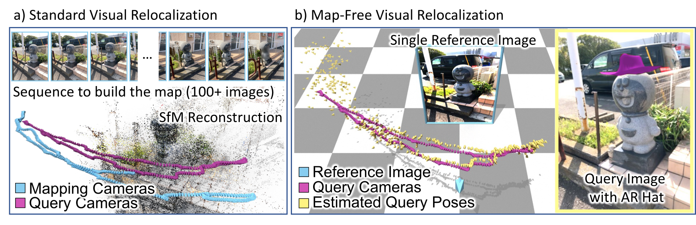

<p align="center">
  <h1 align="center">Map-free Visual Relocalization:<br>Metric Pose Relative to a Single Image</h1>
    <a href="https://earnold.me">Eduardo Arnold</a>
    ·
    <a href="">Jamie Wynn</a>
    ·
    <a href="https://scholar.google.co.uk/citations?user=7wWsNNcAAAAJ">Sara Vicente</a>
    ·
     <a href="https://guiggh.github.io/">Guillermo Garcia-Hernando</a>
    ·
     <a href="https://amonszpart.github.io/">Áron Monszpart</a>
    ·
     <a href="https://www.robots.ox.ac.uk/~victor/">Victor Adrian Prisacariu</a>
    ·
     <a href="https://scholar.google.com/citations?user=ELFm0CgAAAAJ">Daniyar Turmukhambetov</a>
    ·
     <a href="https://twitter.com/eric_brachmann">Eric Brachmann</a>
  </p>
  <h2 align="center">ECCV 2022</h2>
  <h3 align="center"><a href="https://nianticspatial.com/research/map-free">Project Page</a> | <a href="https://storage.googleapis.com/niantic-lon-static/research/map-free-reloc/MapFreeReloc-ECCV22-paper.pdf">Paper</a> | <a href="https://arxiv.org/abs/2210.05494">arXiv</a> | <a href="https://storage.cloud.google.com/niantic-lon-static/research/map-free-reloc/MapFreeReloc-ECCV22-supplemental.pdf">Supplemental</a> </h3> 
  <div align="center"></div>
</p>

This is the reference implementation of the paper **"Map-free Visual Relocalization: Metric Pose Relative to a Single Image"** presented at **ECCV 2022**.

Standard visual relocalization requires hundreds of images and scale calibration to build a scene-specific 3D map. In contrast, we propose Map-free Relocalization, i.e., using only one photo of a scene to enable instant, metric scaled relocalization.

We crowd-sourced a substantial new [dataset](#camera-map-free-visual-relocalization-dataset) for this task, consisting of 655 places. We also define a new benchmark based on this dataset that includes a public [leaderboard](https://nianticspatial.com/research/map-free/leaderboard).

<p align="center">
    
</p>

# Overview

1. [Setup](#nut_and_bolt-setup)
1. [Our dataset](#camera-map-free-visual-relocalization-dataset)
1. [Evaluate your method](#bar_chart-evaluate-your-method)
1. [Visualise your method](#eye-visualise-your-method)
1. [Baselines: Relative Pose Regression](#relative-pose-regression-baselines)
   1. [Single Frame track](#single-frame-track)
   1. [Multi Frame track](#multi-frame-track)
1. [Baselines: Feature Matching + Scale from Estimated Depth](#feature-matching--scale-from-depth-baselines)
1. [Extended Results (7Scenes & Scannet)](#results-on-scannet--7scenes)
1. [Cite](#scroll-cite)
1. [License](#page_with_curl--license)
1. [Changelog](#pencil-changelog)
1. [Acknowledgements](#octocat-acknowledgements)


# :nut_and_bolt: Setup
Using [Anaconda](https://www.anaconda.com/download/), you can install dependencies with 
```shell
conda env create -f environment.yml
conda activate mapfree
```
We used PyTorch 1.8, PyTorch Lightning 1.6.5, CUDA toolkit 11.1, Python 3.7.12 and Debian GNU/Linux 10.

# :camera: Map-free Visual Relocalization Dataset
We introduce a new [dataset](https://nianticspatial.com/research/map-free/dataset) for development and evaluation of map-free relocalization. The dataset consists of 655 outdoor scenes, each containing a small ‘place of interest’ such as a sculpture, sign, mural, etc.

To use our code, download [our dataset](https://nianticspatial.com/research/map-free/dataset) and extract train/val/test.zip files into `data/mapfree`.

## Organization
The dataset is split into 460 training scenes, 65 validation scenes and 130 test scenes.

Each training scene has two sequences of images, corresponding to two different scans of the scene. We provide the absolute pose of each training image, which allows determining the relative pose between any pair of training images.

For validation and test scenes, we provide a single reference image obtained from one scan and a sequence of query images and absolute poses from a different scan.

An exemplar scene contains the following structure:
```
train/
├── s00000
│   ├── intrinsics.txt
│   ├── overlaps.npz
│   ├── poses.txt
│   ├── poses_device.txt
│   ├── seq0
│   │   ├── frame_00000.jpg
│   │   ├── frame_00001.jpg
│   │   ├── frame_00002.jpg
│   │   ├── ...
│   │   └── frame_00579.jpg
│   └── seq1
│       ├── frame_00000.jpg
│       ├── frame_00001.jpg
│       ├── frame_00002.jpg
│       ├── ...
│       └── frame_00579.jpg
```

### **intrinsics.txt**
Encodes per frame intrinsics with format 
```
frame_path fx fy cx cy frame_width frame_height
```

### **poses.txt**
Encodes per frame extrinsics with format 
```
frame_path qw qx qy qz tx ty tz
``` 
where $q$ is the quaternion encoding rotation and $t$ is the **metric** translation vector. 

Note:
- The pose is given in world-to-camera format, i.e. $R(q), t$ transform a world point $p$ to the camera coordinate system as $Rp + t$.
- For val/test scenes, the reference frame (`seq0/frame_00000.jpg`) always has identity pose and the pose of query frames (`seq1/frame_*.jpg`) are given relative to the reference frame. Thus, the absolute pose of a given query frame is equivalent to the relative pose between the reference and the query frames.
- We **DO NOT** provide ground-truth poses for the **test** scenes. These are kept private for evaluation in our [online benchmarking website](https://nianticspatial.com/research/map-free). The poses provided for test sequences are invalid lines containing 0 for all parameters.
- There might be "skipped frames", i.e. the linear id of a frame does not necessarily correspond to its frame number. 

### **overlaps.npz**
Available for **training scenes only**, this file provides the overlap score between any (intra- and inter-sequence) pairs of frames and can be used to select training pairs. The overlap score measures the view overlap between two frames as a ratio in the interval $[0,1]$, computed based on the SfM co-visibility. Details of how this is computed is available in the [supplemental materials](https://storage.cloud.google.com/niantic-lon-static/research/map-free-reloc/MapFreeReloc-ECCV22-supplemental.pdf).

The file contains two numpy arrays: 
- `idxs`: stores the sequences and frame numbers for a pair of images (A, B), for which the overlap is computed. Format: `seq_A, frame_A, seq_B, frame_B`
- `overlaps`: which gives the corresponding overlap score. 

For example, to obtain the overlap score between frames `seq0/frame_00023.jpg` and `seq1/frame_00058.jpg` one would do:
```
f = np.load('overlaps.npz', allow_pickle=True)
idxs, overlaps = f['idxs'], f['overlaps']
filter_idx = (idxs == np.array((0, 23, 1, 58))).all(axis=1)
overlap = overlaps[filter_idx]
```

Note:
- Although we computed overlap scores exhaustively between any two pairs, we only provide rows for pairs of frames with non-zero overlap score.
 
### **poses_device.txt**

> **Do not use for the Single Frame leaderboard!**

Contains the device tracking poses from the phone manufacturer's SDK.  
The format is the same as `poses.txt` (world-to-camera).

- Training scenes: every frame of both sequences, as the absolute pose in the tracking world of its own scan. The two sequences of a scene live in unrelated tracking worlds, so only relative poses within one sequence are meaningful.
- Validation and test scenes: only the frames of the Multi Frame track, every 10th frame (index `0`, `10`, `20`, ...) is omitted. Each burst (indices `1`-`9`, `11`-`19`, ...) is expressed in the camera coordinate system of its query frame (every 10th starting from index `9`: `9`, `19`, `29`, ...). That is, the query frame has identity pose, and frame $i$ of the burst has pose $T_i T_q^{-1}$, where $T_i$ and $T_q$ are the world-to-camera tracking poses of frame $i$ and of the query frame.

> **Note:** The validation and test device poses released before October 2026 were composed as $T_q^{-1} T_i$, which is not the relative pose of the burst frames. Please re-download `val.zip` and `test.zip`. The training device poses were not affected.

<summary>An example pose file <code>poses_device.txt</code> for scene <code>s00525</code> looks like this:
<details>
<pre><code>seq1/frame_00001.jpg 0.9994922102295105 0.0258408088118111 -0.0169212632079548 0.0078259275441657 0.0498988467383806 -0.0226100782727966 -0.0060906781658378
seq1/frame_00002.jpg 0.9993580756977485 0.0317611543353082 -0.0140739236537257 0.0087515876257596 0.0372425127898270 -0.0218463757714544 -0.0099860880687193
seq1/frame_00003.jpg 0.9994095259471332 0.0331201696839304 -0.0066192244238776 0.0063118677315506 0.0261031601053793 -0.0204232243912114 -0.0113829311052808
seq1/frame_00004.jpg 0.9994142780805183 0.0335987864943677 -0.0021863335700750 0.0061190081241007 0.0196521134909996 -0.0184831252144414 -0.0127334564844476
seq1/frame_00005.jpg 0.9994709353778228 0.0318853740457669 0.0000461703841235 0.0064163950343704 0.0124709163817764 -0.0159101105486736 -0.0130498061630956
seq1/frame_00006.jpg 0.9995967761113795 0.0270777673804318 0.0045837890491160 0.0072158561086854 0.0096660603522758 -0.0123593025231904 -0.0109996367832959
seq1/frame_00007.jpg 0.9997700436703243 0.0202573608535443 0.0017049488754487 0.0068258523291487 0.0049083116102863 -0.0084605059672179 -0.0084934711468535
seq1/frame_00008.jpg 0.9999591047718723 0.0089121103024928 -0.0001566603921205 0.0015292257234668 0.0024200289047776 -0.0047788295939500 -0.0031158683196511
seq1/frame_00009.jpg 1.0000000000000000 -0.0000000000000000 0.0000000000000000 0.0000000000000000 0.0000000000000000 0.0000000000000000 0.0000000000000000
seq1/frame_00011.jpg 0.9999122095594510 -0.0045636561919172 0.0013754046358893 0.0123634331067882 -0.0036242201588647 0.0081539166232041 0.0076226163904556
seq1/frame_00012.jpg 0.9998977736441176 -0.0065895823037431 0.0001372511732892 0.0126886101963365 -0.0029655843186076 0.0097878189162118 0.0096388078287356
seq1/frame_00013.jpg 0.9998630582423603 -0.0080067579750605 0.0020132336345454 0.0143423665862987 -0.0023305845359085 0.0086978746205671 0.0076047183492142
seq1/frame_00014.jpg 0.9998568943503410 -0.0087037160617285 0.0027952743596939 0.0142345561245112 -0.0007509039101203 0.0084064814769101 0.0073843547895341
seq1/frame_00015.jpg 0.9999031283748958 -0.0090488179392246 0.0047799001090000 0.0094342628195333 -0.0022666118275397 0.0073931754007798 0.0070065932417983
seq1/frame_00016.jpg 0.9999428136721079 -0.0047474019914475 0.0075837139676094 0.0058582285972304 -0.0024927005813064 0.0062645376410965 0.0047984124936511
seq1/frame_00017.jpg 0.9999532437829465 -0.0005754268438915 0.0093269105346010 0.0024875433242697 -0.0026313272759615 0.0039838480945593 0.0012469642823619
seq1/frame_00018.jpg 0.9999822266501244 -0.0001202180906940 0.0058534089229638 0.0011267366376198 -0.0010192856704233 0.0030255868393124 0.0007250895576328
seq1/frame_00019.jpg 1.0000000000000000 -0.0000000000000000 -0.0000000000000000 0.0000000000000000 0.0000000000000000 -0.0000000000000000 0.0000000000000000
seq1/frame_00021.jpg 0.9991174013672383 0.0036856127474561 -0.0418335176660942 -0.0008895749172757 0.0658169052240616 0.0088170333767697 -0.0243840277703589
seq1/frame_00022.jpg 0.9990560272980278 0.0030369324318035 -0.0433329604959047 0.0002930794220293 0.0655661950286394 0.0081346103404065 -0.0215663829248162
seq1/frame_00023.jpg 0.9990875936564162 0.0013592003450472 -0.0426843999781435 0.0004180607129125 0.0621101622706778 0.0072764515386411 -0.0180417276438980
seq1/frame_00024.jpg 0.9992377262165001 0.0017900047356259 -0.0389964038538644 -0.0002070632542871 0.0560026350606111 0.0061524644136168 -0.0153687619047749
seq1/frame_00025.jpg 0.9993967525683742 0.0031765329068422 -0.0345377562084978 -0.0017843739971673 0.0470636019002797 0.0048158679520645 -0.0114069628886592
seq1/frame_00026.jpg 0.9995529645977504 -0.0008573053739030 -0.0298268519649869 -0.0018694633461822 0.0372736444655148 0.0030758350480336 -0.0070880699408346
seq1/frame_00027.jpg 0.9997698960436624 -0.0042028396147097 -0.0207036963210706 -0.0037212985183076 0.0258547853603958 0.0014848211196102 -0.0050162928390153
seq1/frame_00028.jpg 0.9999206320562990 -0.0048948701062151 -0.0112755198043194 -0.0027626957699021 0.0135155478784580 0.0001106119456722 -0.0024998368940047
seq1/frame_00029.jpg 1.0000000000000000 0.0000000000000000 -0.0000000000000000 -0.0000000000000000 -0.0000000000000000 0.0000000000000000 0.0000000000000000
seq1/frame_00031.jpg 0.9995818922678263 -0.0120292945268753 0.0043424168431252 -0.0259322220300923 0.1252702940573129 0.0047406527856030 -0.0590105863162850
# ...</code></pre></details></summary>

## Data Loader
We provide a reference PyTorch dataloader for our dataset in [lib/datasets/mapfree.py](lib/datasets/mapfree.py).

# :bar_chart: Evaluate Your Method 
We provide an [online benchmark website](https://nianticspatial.com/research/map-free) to evaluate submissions on the test set.  
There are two tracks: [Single Frame](https://nianticspatial.com/research/map-free/leaderboard?t=single) and [Multi Frame](https://nianticspatial.com/research/map-free/leaderboard?t=multi9).

Note that, for the **Single Frame** public leaderboard, **we only allow submissions that use single query frames** for their estimates. That is, methods using multi-frame queries are not allowed.  
For the **Multi Frame** public leaderboard, we allow submissions that use up to 9 query frames (very specifically, the query frame and the 8 frames __before__ it) and the provided device tracking poses of those query frames for their estimates.  
Methods using full query scans for their estimates are still **not** allowed.

## Submission Format
The submission file is a ZIP file containing one txt file per scene at its root level without any directories:
```
submission.zip
├── pose_s00525.txt
├── pose_s00526.txt
├── pose_s00527.txt
├── pose_s00528.txt
├── ...
└── pose_s00654.txt
```
Each of the text files should contain the estimated pose for the query frame with the same format as [poses.txt](#posestxt), with the additional `confidence` column: 
```
frame_path qw qx qy qz tx ty tz confidence
```

### Single Frame track

Note that the evaluation for the Single Frame leaderboard only considers every 5th frame of the query sequence, so one does not have to compute the estimated pose for all query frames. This is accounted for in [our dataloader](lib/datasets/mapfree.py#L317).

An example pose file `pose_s00525.txt` for scene `s00525` would look like this:
```
seq1/frame_00000.jpg 0.981085 0.020694 0.191351 0.020694 -1.108672 -0.215504 1.129422 519.7958984375
seq1/frame_00005.jpg 0.976938 0.035391 0.209076 0.025041 -1.198505 -0.254750 1.225280 480.41900634765625
seq1/frame_00010.jpg 0.977999 -0.003629 0.207880 0.017071 -1.139382 -0.119754 1.145658 530.1975708007812
seq1/frame_00015.jpg 0.977930 -0.012163 0.207723 0.018884 -1.132435 -0.119024 0.955460 532.3636474609375
seq1/frame_00020.jpg 0.978110 -0.001814 0.207904 0.008536 -1.157719 -0.121681 0.976792 457.1533813476562
seq1/frame_00025.jpg 0.981478 -0.003330 0.190780 0.017132 -1.154860 -0.121381 1.161221 510.46484375
seq1/frame_00030.jpg 0.963484 -0.004664 0.267198 0.016818 -1.262709 -0.132716 1.269665 518.1480102539062
# ...
```

### Multi Frame track

Note that the evaluation for the Multi Frame leaderboard only considers every 10th frame of the query sequence starting with the 10th (index `9`) frame, so one does not have to compute the estimated pose for all query frames. This is accounted for in [our dataloader](lib/datasets/mapfree.py#L321).

An example pose file `pose_s00525.txt` for scene `s00525` would look like this:
```
seq1/frame_00009.jpg 1 0 0 0 1.0 2 3 100 
seq1/frame_00019.jpg 1 0 0 0 1.1 2 3 200 
seq1/frame_00029.jpg 1 0 0 0 1.2 2 3 300 
seq1/frame_00039.jpg 1 0 0 0 1.3 2 3 400 
# ...
```

## Submission Script
We provide a [submission script](submission.py) to generate submission files:
```shell
python submission.py <config file> [--checkpoint <path_to_model_checkpoint>] -o results/your_method
```

The script reads the configuration of the dataset and the model to determine which track it runs.
To switch between the single and multi-frame setup, configure the `QUERY_FRAME_COUNT` variable in the [Map-free dataset file](config/mapfree.yaml#L11) as:
* `QUERY_FRAME_COUNT: 1 # (single frame task)` or
* `QUERY_FRAME_COUNT: 9 # (multi-frame task)`

The model can be also configured accordingly depending on whether it expects single or multiple frames as input. See the [model builder file](lib/models/builder.py).

The resulting file `results/your_method/submission.zip` can be uploaded to our [online benchmark website](https://nianticspatial.com/research/map-free/submit) and compared against existing methods in our [leaderboard](https://nianticspatial.com/research/map-free/leaderboard).

## Local evaluation
We do **NOT** provide ground-truth poses for the test set. But you can still evaluate your method locally, *e.g.* for hyperparameter tuning or model selection, by generating a submission on the **validation set**
```shell
python submission.py <config file> [--checkpoint <path_to_model_checkpoint>] --split val -o results/your_method
```
and evaluate it on the **validation set** using
```shell
python -m benchmark.mapfree results/your_method/submission.zip --split val
```
This is the same script used for evaluation in our benchmarking system, except we use the test set ground-truth poses.

## Examples of submissions for existing baselines
You can generate submissions for the [Relative Pose Regression](#relative-pose-regression-baselines) and [Feature Matching](#feature-matching--scale-from-depth-baselines) baselines using
```shell
# feature matching (SuperPoint+SuperGlue), scale from depth (DPT KITTI), Essential Matrix solver
python submission.py config/matching/mapfree/sg_emat_dptkitti.yaml -o results/sg_emat_dptkitti

# feature matching (LoFTR), scale from depth (DPT NYU), PnP solver
python submission.py config/matching/mapfree/loftr_pnp_dptnyu.yaml -o results/loftr_pnp_dptnyu

# relative pose regression model, 6D rot + 3D trans parametrization
python submission.py config/regression/mapfree/rot6d_trans.yaml --checkpoint weights/mapfree/rot6d_trans.ckpt -o results/rpr_rot6d_trans

# relative pose regression model, 3D-3D correspondence parametrization + Procrustes
python submission.py config/regression/mapfree/3d3d.yaml --checkpoint weights/mapfree/3d3d.ckpt -o results/rpr_3d3d
```
You can explore more methods by inspecting [config/matching/mapfree](config/matching/mapfree) and [config/regression/mapfree](config/regression/mapfree).

# :eye: Visualise Your Method

We provide a script to visualise the estimated poses on the query images. 
The script reads the estimated poses in the submission format and visualises errors with respect to the ground-truth poses, if available, e.g. for the validation set. 
More details can be found in the [visualisation folder](visualisation/). 

# Relative Pose Regression Baselines

##  Pre-trained Models
We provide [Mapfree models](https://storage.googleapis.com/niantic-lon-static/research/map-free-reloc/assets/mapfree_rpr_weights.zip) and [Scannet models](https://storage.googleapis.com/niantic-lon-static/research/map-free-reloc/assets/scannet_rpr_weights.zip) for all the RPR variants presented in the paper/supplemental.
Extract all weights to `weights/`. The models name match the configuration files in `config/regresion/`

## Custom Models
One can customize the existing models by changing *e.g.* encoder type, feature aggregation variant, output parametrisation and loss functions. All these hyper-parameters are specified in the configuration file for a given model variant. See *e.g.* [config/regression/mapfree/3d3d.yaml](config/regression/mapfree/3d3d.yaml).

We provide multiple variants for the [encoder](lib/models/regression/encoder), [aggregator](lib/models/regression/aggregator.py) and [loss functions](lib/utils/loss.py).

One can also define a custom model by registering it in [lib/models/builder.py](lib/models/builder.py). Given a pair of RGB images, the model must be able to estimate the metric relative pose between the pair of cameras.

## Training a Model

### Single Frame track

To train a single frame model, use:
```shell
python train.py config/regression/<dataset>/{model variant}.yaml \
                config/{dataset config}.yaml \
                --experiment experiment_name
                
# Example                
python train.py config/regression/mapfree/3d3d.yaml \
                config/mapfree.yaml \
                --experiment experiment_name
```
Resume training from a checkpoint by adding `--resume {path_to_checkpoint}`

The top five models, according to validation loss, are saved during training.
Tensorboard results and checkpoints are saved into the folder `weights/experiment_name`.

### Multi Frame track

An example call to train a multi frame model:
```shell
python3 train.py config/regression/mapfree/multiframe/3d3d_multi.yaml \
                 config/mapfree.yaml config/mapfree_multi.yaml \
                 --experiment experiment_name
```

To switch between the single and multi frame setup, configure the `QUERY_FRAME_COUNT` variable in the [Map-free dataset file](config/mapfree.yaml#L11) or [config/mapfree_multi.yaml#L2](config/mapfree_multi.yaml#L2) as:
* `QUERY_FRAME_COUNT: 1 # (single frame task)` or
* `QUERY_FRAME_COUNT: 9 # (multi-frame task)`
* > Remember: the second dataset config file (e.g. `config/mapfree_multi.yaml`) overwrites
  > the values in the first (e.g. `config/mapfree.yaml`).

# Feature Matching + Scale from Depth Baselines
We provide different feature matching (SIFT, [SuperPoint+SuperGlue](https://github.com/magicleap/SuperGluePretrainedNetwork), [LoFTR](https://github.com/zju3dv/LoFTR)), depth regression ([DPT](https://github.com/isl-org/DPT) KITTI, NYU) and pose solver (Essential Matrix Decomposition, PnP) variants.

One can choose the different options for matching, depth and pose solvers by creating a configuration file in [config/matching/mapfree/](config/matching/mapfree/). 

## Download correspondences and depth files
To reproduce feature matching methods baselines
- Download [DPT estimated depth maps](https://storage.googleapis.com/niantic-lon-static/research/map-free-reloc/assets/mapfree_dpt_depth.tar.gz).
- Download [feature-matching correspondences](https://storage.googleapis.com/niantic-lon-static/research/map-free-reloc/assets/mapfree_correspondences.zip) (LoFTR and SuperPoint+SuperGlue).
- Extract both files to `data/mapfree`

## Download MicKey correspondences and depth files
We also provide the depth maps and correspondences computed by [MicKey](https://github.com/nianticlabs/mickey).
- Download [MicKey depth maps](https://storage.googleapis.com/niantic-lon-static/research/map-free-reloc/assets/mickey_depths.tar.gz).
- Download [MicKey correspondences](https://storage.googleapis.com/niantic-lon-static/research/map-free-reloc/assets/mickey_correspondences.zip).
- Extract the contents of both files to `data/mapfree`

## Custom feature matching method
We provide pre-computed correspondences (SIFT, SuperGlue+SuperPoint, LoFTR and MicKey) in the path `data/mapfree/{val|test}/{scene}/correspondences_{feature_method}.npz`

To try out your own feature matching methods you need to create a `npz` file storing the correspondences between the reference frame and all query frames for each scene. See steps below:
1. Create a wrapper class to your feature matching method in [etc/feature_matching_baselines/matchers.py](etc/feature_matching_baselines/matchers.py)
2. Add your wrapper into `MATCHERS` in [etc/feature_matching_baselines/compute.py](etc/feature_matching_baselines/compute.py)
3. Execute [etc/feature_matching_baselines/compute.py](etc/feature_matching_baselines/compute.py) using your desired feature matcher on the Mapfree dataset.
4. Create a new configuration file for your feature-matching baseline, *e.g.* modify [config/matching/mapfree/sg_emat_dptkitty.yaml](config/matching/mapfree/sg_emat_dptkitti.yaml) by replacing `SG` in `MATCHES_FILE_PATH` to the name of your matcher.

<details>
<summary> Note on recomputing SG/LoFTR correspondences</summary>

To use SG/LoFTR you need to recursively pull the git submodules using
```shell
git pull --recurse-submodules
```
Then, 
```shell
cd etc/feature_matching_baselines
python compute.py -ds <Scannet or 7Scenes or Mapfree> -m <SIFT or SG or LoFTR>
```
For different 7Scenes pairs variants, include `--pair_txt test_pairs_name.txt`

You also need to download indoor/outdoor weights of LoFTR and extract them to `etc/feature_matching_baselines/weights/`.
</details>

## Custom depth estimation method
We provide estimated **metric depth maps** in `data/mapfree/{val|test}/{scene}/{seq}/frame_{framenum}.dpt{kitti|nyu}.png` (see the [dataset section](#map-free-visual-relocalization))

To try your own depth estimation method you need to provide **metric** depth maps (`png`, encoded in **millimeters**) for each image the the validation/test set.

For example, `data/mapfree/test/s00525/frame_00000.jpg`, will have corresponding depth map `data/mapfree/test/s00525/frame_00000.yourdepthmethod.png`.

To use the custom depth maps, create a new config file, see *e.g.* [config/matching/mapfree/sg_emat_dptkitty.yaml](config/matching/mapfree/sg_emat_dptkitti.yaml), and add the key `ESTIMATED_DEPTH: 'yourdepthmethod'`.

**Externally provided custom depth estimation methods:**
- [KBR depth predictions](https://github.com/jspenmar/slowtv_monodepth#mapfreereloc)
- [DAv3 depth predictions](https://drive.google.com/file/d/1Gruq6QIFqROwUJLpIGYhN4MjAEoJIkvn/view?usp=sharing) (using [DAv3 DA3NESTED-GIANT-LARGE](https://github.com/ByteDance-Seed/Depth-Anything-3), provided by [David Nordström](https://github.com/davnords))

## Custom pose solver
We provide three [pose solvers](lib/models/matching/pose_solver.py): Essential Matrix Decomposition (with metric pose using estimated depth), Perspective-n-Point (PnP) and Procrustes (rigid body transformation given 3D-3D correspondences).

You can add your custom solver to [lib/models/matching/pose_solver.py](lib/models/matching/pose_solver.py) by creating a class that implements `estimate_pose(keypoints0, keypoints1, data)`, where `keypoints` are the image plane coordinates of correspondences and `data` stores all information about the images, including estimated depth maps.

After creating your custom solver class, you need to register it in the [FeatureMatchingModel](lib/models/matching/model.py).

Finally, you can use it by specifying `POSE_SOLVER: 'yourposesolver'` in the configuration file.

# Results on Scannet & 7Scenes
See [this page](benchmark/extended_datasets.md).

# :scroll: Cite
Please cite our work if you find it useful or use any of our code
```latex
@inproceedings{arnold2022mapfree,
      title={Map-free Visual Relocalization: Metric Pose Relative to a Single Image},
      author={Arnold, Eduardo and Wynn, Jamie and Vicente, Sara and Garcia-Hernando, Guillermo and Monszpart, {\'{A}}ron and Prisacariu, Victor Adrian and Turmukhambetov, Daniyar and Brachmann, Eric},
      booktitle={ECCV},
      year={2022},
    }
```

# :page_with_curl:  License
Copyright © Niantic, Inc. 2022. Patent Pending. All rights reserved. This code is for non-commercial use. Please see the [license file](LICENSE) for terms.

# :pencil: Changelog
- 21/10/2026: corrected validation and test device poses (`poses_device.txt`)
- 02/08/2024: added visualisation scripts
- 31/08/2023: updated README.md with externally provdided depthmaps 
- 22/06/2023: updated README.md leaderboard links
- 20/02/2023: benchmark/mapfree.py gives more helpful warnings
- 13/02/2023: updated LICENSE terms

# :octocat: Acknowledgements
We use part of the code from different repositories. We thank the authors and maintainers of the following repositories.
- [CAPS](https://github.com/qianqianwang68/caps)
- [DPT](https://github.com/isl-org/DPT)
- [ExtremeRotation](https://github.com/RuojinCai/ExtremeRotation_code)
- [LoFTR](https://github.com/zju3dv/LoFTR)
- [PlaneRCNN](https://github.com/NVlabs/planercnn)
- [SuperGlue](https://github.com/magicleap/SuperGluePretrainedNetwork)
- [visloc-relapose](https://github.com/GrumpyZhou/visloc-relapose)
